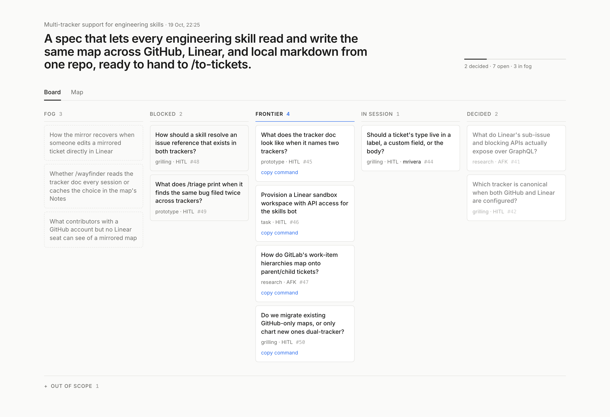

# wayfinder-board

Renders a [Wayfinder](https://github.com/mattpocock/skills) map as a board you can read at a glance: a plain `## What it does` section (or the destination when there is none) as the headline, then fog, blocked, frontier, in-session and decided tickets, each referred to by name. A second view draws the blocking graph, ending in the fog. Frontier cards copy the `/wayfinder` command that picks them up.

It reads the map and its tickets in one `gh api graphql` call using your existing `gh` login. The only write it ever makes is a Mermaid diagram between `<!-- wayfinder-board:start -->` markers in the map body.



## Install

```sh
npx skills add <owner>/wayfinder-board   # /wayfinder-board in Claude Code
npm i -g wayfinder-board                 # the CLI
```

## Usage

```sh
wayfinder-board <map-issue-url | .scratch/<effort>/map.md | repo-dir>... [--html out/board.html] [--post] [--open]
```

A repo directory stands for every effort under its `.scratch/` that isn't done. Each effort sits in one **stage**, and the all-maps page opens with an effort strip grouped by stage:

- **Charting**: the map still has fog or undecided tickets. The board you know.
- **Needs tickets**: the map says `Status: complete` (or has nothing left to decide) and no implementation tickets exist yet. One frontier card copies `/to-tickets <spec.md>`.
- **Implementing**: `.scratch/<effort>-impl/issues/` holds slices from `/to-tickets`, some still open. The effort's tab shows them as queued, ready, in session and done, with the decisions folded away; ready cards copy `/implement <ticket>`; the graph view draws the slices' blocking graph.
- **Done**: every slice done. The effort drops off the repo scan; pass its map path to see it anyway.

Repos are re-scanned on each load, so a `--serve` board picks up maps charted after it started.

Pass several maps and the page opens on **All maps**, every map's in-session and frontier tickets on one board, each card naming its map, with a tab per map behind it. `[` and `]` cycle maps. The list of maps is the command line, so a repo's open maps are one shell expansion away:

```sh
wayfinder-board $(gh issue list --label wayfinder:map --state open --json url -q '.[].url') --serve
```

In Claude Code: `/wayfinder-board <map-url>` runs it with `--html --open --post`, and `/wayfinder-run <map-url>` works the whole frontier: a subagent per ticket, AFK ones in parallel, HITL questions relayed to you grouped by topic. `.github/workflows/board.yml` re-posts the diagram when a map or its tickets change.

`--serve [--port 4173] [--poll 30]` serves a live board instead: each load re-reads the tracker, and the page checks for changes every `--poll` seconds.

Keys: `1` board, `2` map, `0` fit the map, `[` / `]` previous / next map.

## Decisions

- **Closed but listed nowhere** on the map counts as decided; it's out of scope only when the Out of scope section links it.
- **Claimed beats blocked**: an assigned open ticket is in session even if a blocker is still open.
- **Untyped tickets** stay in their state column, labelled `untyped`, with no HITL/AFK.
- **The workflow** triggers on `issues` plus an hourly sweep and manual dispatch: Actions has no `sub_issues` or dependency trigger, so linking and blocking changes land within the hour.
- **Map layout** runs at render time; nodes with successors are pulled right after longest-path layering so edges don't cross columns needlessly.
- **Live board** flags `map changed, refresh` rather than reloading itself, so zoom and hover state survive until you choose.
- **`/wayfinder-run`** keeps one ticket per session by giving each ticket its own subagent; the orchestrator only relays answers verbatim and is the map's sole writer. Tasks count as HITL unless their body makes AFK plain.
- **Notes** are parsed into the model but not shown; the brief's masthead has no place for them.
- **Local markdown**: tickets are claimed by `Status: claimed`; an optional `Assignee:` line names who. `Status:` and `**Status:**` both count, as do `Blocked by:` and `**Blocked by:**`.
- **A map is complete** when it carries a `Status: complete` line near the top, or when nothing is left to decide. The line exists because fog can deliberately outlive a finished map.
- **Slices** are found by the `<effort>-impl/issues/` convention only, and parsed with the same vocabulary as decision tickets: `claimed` is in session, `done`/`resolved`/`closed` is done, anything else unblocked is ready. A `ready-for-human` label (in `Labels:` or `Status:`) marks a slice for a person: it shows the flag and offers no `/implement` command. `## Resolution` is content, not state.
- **Slices stay out of `tickets[]`** in `--json`: they are `impl[]`, with `stage` beside them, so `/wayfinder-run` never claims one.
- **GitHub maps** have no slice stage yet: on GitHub the slices would be sub-issues of the spec issue, and no GitHub map has reached that point.
- **Several maps** stay separate models; the all-maps view is a render-time projection, and the graphs stay per map because tickets don't block across maps.
- **Limits**: the first 100 sub-issues and 20 blockers per ticket; titles in the map view wrap by character count.

## Develop

```sh
npm i && npm test && npm run typecheck && npm run lint
npx tsx scripts/render-fixture.ts && npm run shots   # out/board.html, out/shots/*.png
```
# wayfinder-board
